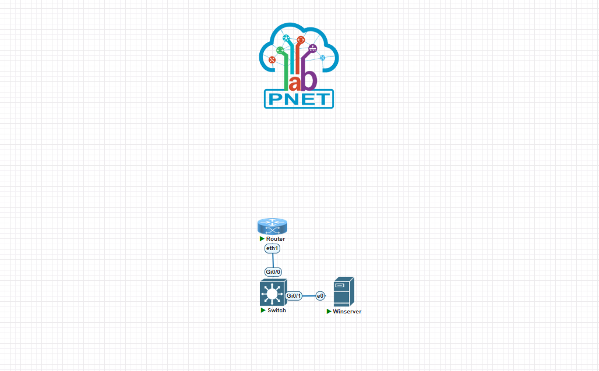
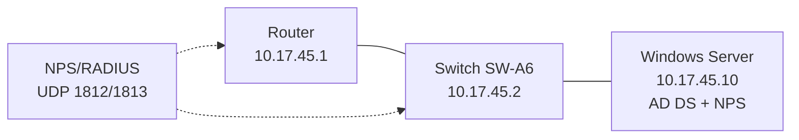

# Asignación 6 — Seguridad de Redes

## Video demostrativo

**Enlace:** pendiente de grabación y publicación en YouTube.

Este enlace debe permanecer al principio del repositorio, tal como solicita la asignación.

## Propósito

Implementar autenticación, autorización, registro y acceso remoto seguro en un router y un switch, usando un servidor Windows Server con Active Directory y NPS como servidor RADIUS.

## Topología

## Direccionamiento basado en matrícula

Matrícula: **20221745**. Se utilizó la red `10.17.45.0/24`.

| Equipo | Dirección | Función |
|---|---:|---|
| Router | 10.17.45.1/24 | SSH, usuario local y cliente RADIUS |
| Switch | 10.17.45.2/24 | AAA, SSH y cliente RADIUS |
| Windows Server | 10.17.45.10/24 | AD DS, grupos y NPS |

## Evidencia principal

- Dominio: `lab.local`.
- Grupos: `Nivel-0`, `Nivel-5`, `Nivel-10`.
- Cliente RADIUS: Router-A6 y Switch-A6.
- Política NPS: `A6-Lab-Admins`.
- Prueba RADIUS: `Access-Accept`.

La documentación completa está en [`docs/INFORME.md`](docs/INFORME.md). Los comandos para la grabación están en [`docs/GUIA-DEMOSTRACION.md`](docs/GUIA-DEMOSTRACION.md).
